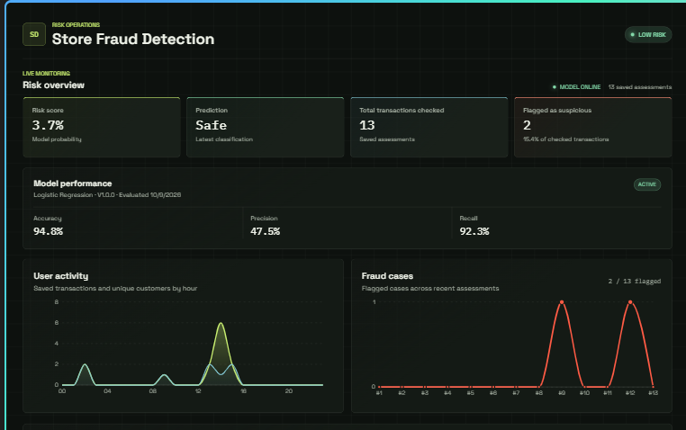

# Store Fraud Detection | Machine Learning Project

I built a fraud detection application that scores financial transactions and presents the results in an interactive risk-monitoring dashboard. The project brings together a machine learning workflow, REST API, database-backed assessment history, and a web interface.

## What it does

- Accepts transaction details and returns a fraud prediction with a probability score.
- Displays recent assessments, flagged transactions, model status, and performance metrics.
- Stores assessments for history and summary analytics.
- Includes data preparation, model evaluation, drift-monitoring, and retraining workflow code.

## Project dashboard

The dashboard brings the transaction review workflow into one screen. It shows model status, saved assessment and flagged-transaction totals, and evaluation metrics, alongside charts for user activity, fraud cases, and recent risk scores. A transaction form lets a reviewer enter transaction details, run an assessment, and inspect the predicted fraud probability and classification.

## Technology used

- **Machine learning:** Python, pandas, NumPy, scikit-learn, joblib; balanced logistic regression for the configured production model.
- **Backend:** FastAPI, Pydantic, SQLAlchemy, Uvicorn.
- **Frontend:** React, Vite, Recharts.
- **Workflow and deployment:** DVC pipeline configuration, Docker, pytest.
- **Data:** Transaction data supplied with the project, including processed training data and a separate evaluation report.

## Evaluation snapshot

The project's saved evaluation report records **94.77% accuracy**, **92.33% fraud recall**, and **47.50% fraud precision**. The high recall reflects the model's emphasis on catching fraudulent cases; the lower precision means some legitimate transactions may also be flagged and would need review. These are project evaluation results, not a guarantee of real-world performance.

## What I learned

This project gave me hands-on experience connecting an imbalanced-classification model to an API and a usable dashboard, persisting prediction history, and making model trade-offs visible to users. It also highlights why accuracy alone is not enough when evaluating fraud detection systems.

**Project repository:** []

**Demo:** [Add a publicly accessible demo link, if available]

#MachineLearning #FraudDetection #Python #FastAPI #React #DataScience #MLOps
